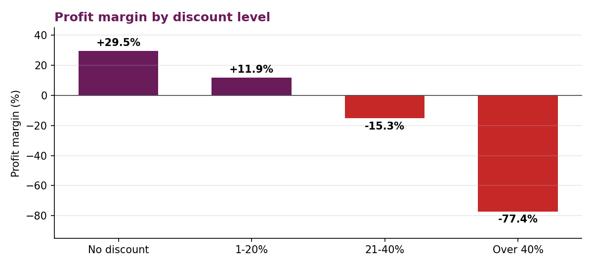
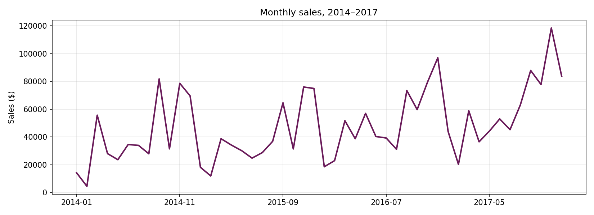
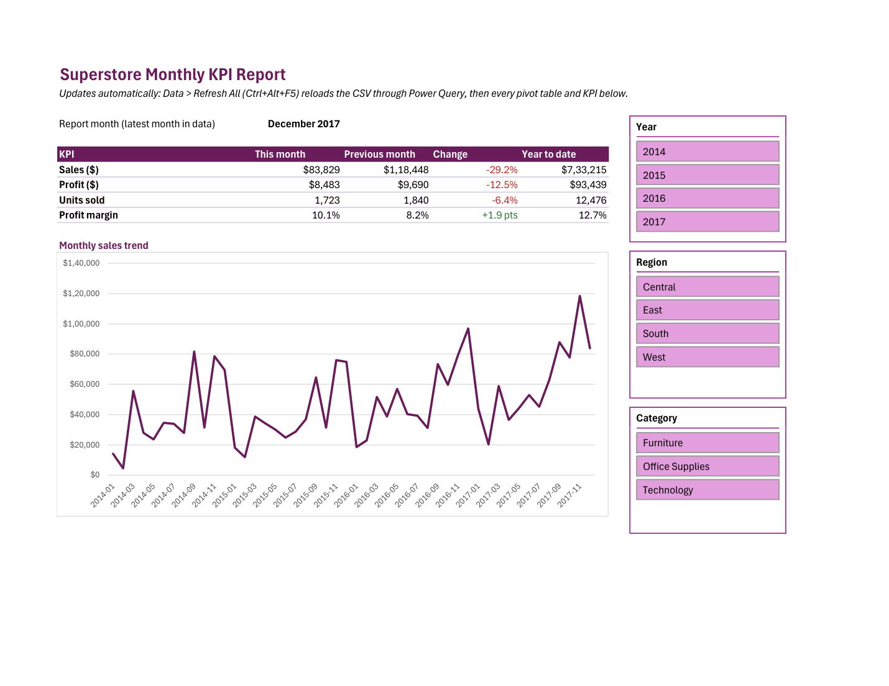

# Superstore Sales Performance Analysis & KPI Dashboard

An end-to-end data analysis project using **Python, SQL, Excel and Power BI**. I took ~10,000 rows of raw retail sales data, cleaned and validated them, calculated business KPIs in SQL, built a monthly Excel report that updates with one click, and designed an interactive Power BI dashboard.

**Dataset:** [Sample Superstore](https://www.kaggle.com/datasets/vivek468/superstore-dataset-final): 9,994 order lines from a US retail store, Jan 2014 to Dec 2017 (orders, customers, products, regions, sales, discount, profit).

---

## Key insights

| # | Finding | Evidence |
|---|---|---|
| 1 | **Sales grew 51.5% in four years**, from $484K (2014) to $733K (2017), after a small 2.8% dip in 2015. | [`02_yearly_yoy_growth`](outputs/02_yearly_yoy_growth.csv) |
| 2 | **Strong year-end seasonality:** September, November and December are the three highest-selling months in *every* year. | [`03_monthly_trend`](outputs/03_monthly_trend.csv) |
| 3 | **Discounts above 20% lose money.** Lines with no discount earn a 29.5% margin. At 21–40% the margin is −15.3%, and above 40% it is −77.4% (−$99.6K profit). | [`08_discount_vs_margin`](outputs/08_discount_vs_margin.csv) |
| 4 | **Three sub-categories are loss-making overall:** Tables (−$17.7K, average discount 26%), Bookcases (−$3.5K) and Supplies (−$1.2K). | [`07_loss_making_subcategories`](outputs/07_loss_making_subcategories.csv) |
| 5 | **West leads; Central lags.** West brings 31.6% of sales at a 14.9% margin. Central has only a 7.9% margin, the lowest of all regions. | [`06_region_performance`](outputs/06_region_performance.csv) |
| 6 | **High sales ≠ high profit.** The #3 product (Cisco TelePresence EX90) and the #1 customer by sales both *lost* money. | [`04_top10_products`](outputs/04_top10_products.csv), [`10_top10_customers`](outputs/10_top10_customers.csv) |

**Recommendations:** cap routine discounts at 20%; review pricing and discounting on Tables and Bookcases; investigate discounting in the Central region; build inventory and marketing ahead of the Sep–Dec peak.



---

## Project workflow

```
Raw CSV ──► Python (Pandas) cleaning ──► Clean CSV ──┬──► SQLite star schema ──► 11 SQL KPI queries ──► outputs/*.csv
                                                    ├──► Excel: Power Query ──► pivot tables + KPI report (1-click refresh)
                                                    └──► Power BI: DAX measures ──► interactive dashboard
```

### 1. Data cleaning: Python / Pandas
[`notebooks/01_data_cleaning.ipynb`](notebooks/01_data_cleaning.ipynb)
- Read the non-UTF-8 source file correctly (latin-1).
- Found and removed **1 duplicate order line** hidden behind a unique `Row ID`.
- Converted text dates to real dates, and restored lost leading zeros in postal codes (`5408` → `05408`).
- Standardised column names to snake_case and added derived fields: `order_year`, `order_month`, `ship_days`, `profit_margin`, `is_loss`.
- Ran 6 automated validation checks (no nulls, no duplicates, ship date ≥ order date, valid discounts…) and exported `data/processed/superstore_clean.csv`.



### 2. KPI analysis: SQL (SQLite)
- [`sql/load_to_sqlite.py`](sql/load_to_sqlite.py) loads the clean data into a **star schema**: `fact_sales` plus `dim_customer` and `dim_product`.
- [`sql/kpi_queries.sql`](sql/kpi_queries.sql) contains **11 KPI queries**, run by [`sql/run_queries.py`](sql/run_queries.py), with results saved to [`outputs/`](outputs/).

| SQL technique | Used for |
|---|---|
| `JOIN`, `GROUP BY`, `HAVING` | product, customer and segment KPIs; loss-making sub-categories |
| CTEs (`WITH`) | yearly and monthly aggregates, ranking pipelines |
| `LAG()` window function | year-over-year sales and profit growth |
| `SUM() OVER (PARTITION BY … ORDER BY …)` | year-to-date running totals |
| `AVG() OVER (ROWS BETWEEN 2 PRECEDING …)` | 3-month moving average |
| `RANK()`, `DENSE_RANK()`, `ROW_NUMBER()` | top-10 products and customers, top-3 sub-categories per region |
| `SUM(SUM()) OVER ()` | share of total sales |
| `CASE` | discount bands |

### 3. Automated monthly report: Excel
[`excel/Superstore_Monthly_KPI_Report.xlsx`](excel/Superstore_Monthly_KPI_Report.xlsx)
- **Power Query** loads and types the clean CSV. The file path is stored in a named cell on the *Settings* sheet, so the source can change without editing the query.
- **Pivot tables** show monthly sales, profit and units, plus region × category sales and profit. They are filtered together by **Year / Region / Category slicers**.
- The **KPI report** always shows the *latest month in the data*: this month, previous month, change % and year-to-date, built with `SUMIFS`/`EOMONTH`.
- **One-click update:** add new rows to the CSV, then *Data → Refresh All*. The query, every pivot table, the chart and the KPIs update. This was tested by refreshing with data up to Nov 2017: the report switched to November automatically.



### 4. Interactive dashboard: Power BI
[`powerbi/`](powerbi/): the dashboard file and the custom theme [`plum_theme.json`](powerbi/plum_theme.json).
- DAX measures: Total Sales, Total Profit, Profit Margin %, Total Orders, Avg Order Value, Sales PY (`SAMEPERIODLASTYEAR`) and Sales YoY %.
- A date table marked as the model's date table, related to `order_date`.
- KPI cards, a monthly trend line, region and sub-category bars (losses in red), a segment donut, and Year / Region / Category slicers.

*Dashboard screenshot: coming soon*

---

## How to run

```bash
pip install pandas matplotlib nbformat nbconvert ipykernel
jupyter nbconvert --to notebook --execute --inplace notebooks/01_data_cleaning.ipynb   # or open and run it
python sql/load_to_sqlite.py      # builds data/superstore.db
python sql/run_queries.py         # runs all KPI queries and writes outputs/*.csv
```
- **Excel:** open the workbook. If you cloned the repo to a different folder, update the CSV path on the *Settings* sheet, then click *Data → Refresh All*.
- **Power BI:** open `powerbi/Superstore_Sales_Dashboard.pbix`. If needed, change the source in *Transform data → Data source settings*.

## Repository structure

```
data/raw/            original Superstore CSV
data/processed/      cleaned CSV (input for SQL, Excel and Power BI)
notebooks/           Pandas cleaning notebook
sql/                 loader, KPI queries, query runner
outputs/             KPI query results (CSV)
excel/               Power Query + pivot table monthly KPI report
powerbi/             dashboard, theme
images/              charts and screenshots
```

**Tools:** Python (Pandas, Matplotlib) · SQL (SQLite) · Excel (Power Query, Pivot Tables, Slicers) · Power BI (DAX) · Git

*Author: Maria Sherlin · [LinkedIn](https://www.linkedin.com/in/maria-sherlin-a-34a57228b/) · [GitHub](https://github.com/MariaSherlin-A)*
